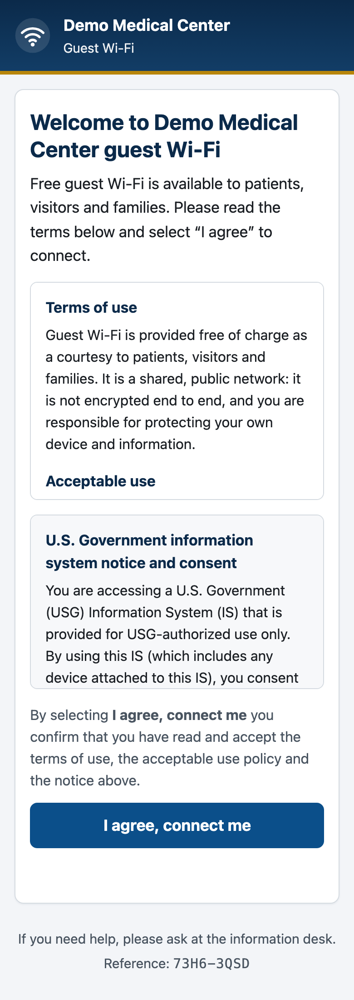
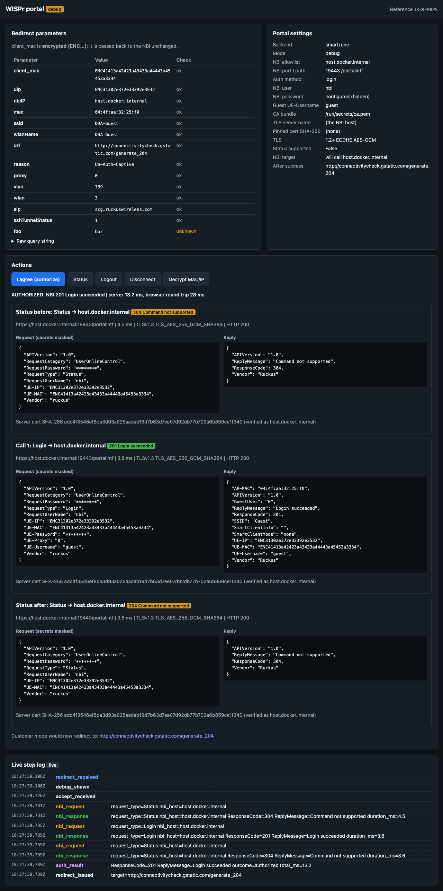

# WISPr external captive portal: RUCKUS SmartZone and RUCKUS One

A click-through guest portal for RUCKUS Hotspot (WISPr) WLANs. The guest reads the terms and
selects **I agree**. Then the **portal server** calls the controller's WISPr northbound
interface (NBI) to authorize the guest's device. The browser never talks to the controller,
and the NBI credentials never reach the browser.

- **Backends:** `smartzone` (SZ 7.x, including 7.1.1.3 FIPS) and `r1` (RUCKUS One). Chosen per deployment.
- **Modes:** `customer` (production-style hospital guest page) and `debug` (shows every redirect parameter, the NBI request and reply, timings and a live step log). The flow underneath is the same.
- Built for the DHA Round 3 guest-wireless demo (requirement 7: externally hosted third-party portal where the guest accepts terms), but nothing in it is DHA-specific apart from the default notice text.

NBI details, sources and open questions: **[SZ-wispr-api.md](SZ-wispr-api.md)** (SmartZone) and
[R1-wispr-api.md](R1-wispr-api.md) (RUCKUS One).

| Customer mode | Debug mode |
|---|---|
|  |  |

More screenshots (desktop + phone, terms / connecting / success / error / debug) are in [`docs/`](docs/).

## How it works

```
guest ──HTTP(S)──> AP / SZ captive portal ──302──> https://portal/?client_mac=ENC..&uip=ENC..&nbiIP=..&url=..
guest ──GET /?...────────────────────────────────> portal: validate params, show terms   (redirect_received, terms_shown)
guest ──POST /accept (CSRF token)───────────────> portal                                 (accept_received)
                                                   portal ──POST https://<nbiIP in allowlist>:9443/portalintf──> SZ NBI
                                                          {RequestType: Login, UE-MAC/UE-IP as received, ...}   (nbi_request)
                                                   portal <──{ResponseCode: 201 "Login succeeded"}────────────   (nbi_response, auth_result)
guest <──"You are connected" + refresh to startUrl/url──                                 (success_shown, redirect_issued)
```

On SmartZone the default request is **`Login` with a fixed guest user name against an
Always-Accept authentication service**. The public SZ guide has no click-through `Authorize`
command. `Authorize` is an opt-in for the lab test (`SZ_AUTH_METHOD=authorize`). On RUCKUS One
the default is `Authorize`, as before. See [SZ-wispr-api.md §2](SZ-wispr-api.md#2-click-through-authorize-or-login).

## Quick start

```bash
python3.12 -m venv .venv && .venv/bin/pip install -r requirements-dev.txt
.venv/bin/python -m pytest -q                     # unit + end-to-end tests (fake NBI over real TLS)
```

Local demo against the fake NBI (no controller needed):

```bash
.venv/bin/python tools/fake_nbi.py --port 19443 --password nbi-secret --ca-out /tmp/fake-ca.pem &
PORTAL_MODE=debug PORTAL_BACKEND=smartzone SZ_NBI_HOSTS=127.0.0.1 SZ_NBI_PORT=19443 \
SZ_NBI_USERNAME=nbi SZ_NBI_PASSWORD=nbi-secret SZ_CA_BUNDLE=/tmp/fake-ca.pem \
.venv/bin/python server.py
# open http://127.0.0.1:8080/?client_mac=ENC41413a42423a43433a44443a45453a3031&uip=ENC31302e372e33392e3530&nbiIP=127.0.0.1&url=http%3A%2F%2Fexample.com%2F
```

(The fake NBI's "encryption" is plain hex: `ENC` + hex of the clear text.)

## Deploy (Docker, lab Linux VM)

```bash
docker build -t wispr-portal .
install -d -m 700 secrets
printf '%s' 'the-NBI-password'      > secrets/sz_nbi_password
openssl rand -hex 32                 > secrets/secret_key
cp portal-cert.pem portal-key.pem ca.pem secrets/   # portal TLS cert/key + CA that signed the SZ NBI cert
chmod 644 secrets/*                  # the container runs as uid 10001

docker run -d --name wispr-portal --restart unless-stopped -p 443:8443 \
  -v "$PWD/secrets:/run/secrets:ro" \
  -e PORTAL_MODE=customer -e PORTAL_BACKEND=smartzone -e PORT=8443 \
  -e TLS_CERT_FILE=/run/secrets/portal-cert.pem -e TLS_KEY_FILE=/run/secrets/portal-key.pem \
  -e SZ_NBI_HOSTS=192.168.37.6,192.168.37.8 -e SZ_NBI_USERNAME=portal \
  -e SZ_NBI_PASSWORD_FILE=/run/secrets/sz_nbi_password -e SZ_CA_BUNDLE=/run/secrets/ca.pem \
  -e SECRET_KEY_FILE=/run/secrets/secret_key \
  -e FACILITY_NAME="Demo Medical Center" \
  wispr-portal
docker logs -f wispr-portal        # JSON lines, one per step
curl -s https://portal.example/healthz
```

- The image runs as a non-root user (uid 10001), with code owned by root and read-only to that user. Port 8080 (HTTP) or 8443 with `TLS_CERT_FILE`/`TLS_KEY_FILE`.
- Debug and customer can run side by side as two containers on two ports or hosts. Run debug only in the lab.
- One gunicorn worker with 16 threads. Rate limits and `/events` live in-process, so don't scale workers up without moving them to shared storage.
- Cloud Run (later): set the same env vars. Use Secret Manager for `*_FILE` mounts. Cloud Run terminates TLS, so leave `TLS_*` unset and set `TRUST_PROXY_HOPS=1` and `COOKIE_SECURE=1`. The NBI must then be reachable from Cloud Run, which is not the case for the DHA lab.

## SmartZone setup (done by the DHA-Wi-Fi session, not from here)

1. **NBI:** *Administration > External Services > WISPr Northbound Interface*: enable *Northbound Portal Interface Support* and set the user name and password (FIPS CG p.63). These become `SZ_NBI_USERNAME` / `SZ_NBI_PASSWORD`.
2. **Authentication service:** for click-through, use **Always Accept** on the WLAN (*Authentication Service*). Local DB or RADIUS also work, with `SZ_GUEST_USERNAME`/`SZ_GUEST_PASSWORD` set to a real account.
3. **Hotspot (WISPr) portal profile** (*Services > Hotspots & Portals > Hotspot (WISPr)*):
   - Logon URL **External**, `https://<portal host>/` (the portal reads the query string on `/`).
   - Start page: either option works. The portal sends the guest to `startUrl`, then `url`, then `DEFAULT_REDIRECT_URL`.
   - Redirected MAC format: any. The portal passes `client_mac` back exactly as received.
   - HTTPS redirect: optional (see the Apple CNA note in SZ-wispr-api.md §8).
   - **Walled garden:** the portal host (its DNS name **and** IP, if guests resolve it). Add the OS captive-portal probe hosts only if you want them to bypass the portal (normally leave them out so the OS opens the portal).
   - Session timeout / grace period: as DHA requires (the NBI does not set them).
4. **WLAN:** authentication type **Hotspot (WISPr)**, with the portal profile above and the authentication service from step 2. In FIPS mode Guest Access, Web-Auth and Open-None WLANs are disabled (FIPS CG p.153-154). Hotspot (WISPr) with OWE or an open method is the path to prove.
5. **Encryption of MAC/IP:** leave it on (the default; CLI `show running-config encrypt-mac-ip`). The portal works either way.
6. **Network:** the portal host must be reachable from the guest VLAN (walled garden) and must reach SZ TCP **9443** on the nodes in `SZ_NBI_HOSTS`. Nothing else needs to reach the portal. The SZ never calls the portal.
7. **TLS on 9443:** either import a certificate the portal can verify for the NBI address (lab CA), or keep the factory certificate and set `SZ_TLS_SERVER_NAME=scg.ruckuswireless.com`, `SZ_CA_BUNDLE=<Ruckus CA>` and `SZ_CERT_SHA256=<leaf fingerprint>`. The portal never skips verification.

Get the fingerprint without trusting it blindly (do this on the lab network, then compare it with the SZ UI):
`openssl s_client -connect 192.168.37.6:9443 </dev/null 2>/dev/null | openssl x509 -noout -fingerprint -sha256`

## Configuration (environment)

Every secret also accepts `NAME_FILE=/path` (file contents win). The app refuses to start on a
missing or invalid setting.

### General

| Variable | Default | Meaning |
|---|---|---|
| `PORTAL_MODE` | `customer` | `customer` or `debug` |
| `PORTAL_BACKEND` | `smartzone` | `smartzone` or `r1` |
| `SECRET_KEY` (`_FILE`) | random per start | Signs the session cookie (CSRF token + validated params). ≥ 32 chars. Set it so restarts don't expire open pages. |
| `BIND_ADDR` / `PORT` | `0.0.0.0` / `8080` | Listen address (gunicorn) |
| `TLS_CERT_FILE` / `TLS_KEY_FILE` | unset | Serve HTTPS (TLS 1.2+, ECDHE-AES-GCM). Enables HSTS and Secure cookies. |
| `COOKIE_SECURE` | on if TLS | Force the Secure flag (behind a TLS proxy) |
| `TRUST_PROXY_HOPS` | `0` | Number of reverse proxies whose `X-Forwarded-*` headers to trust (client IP for rate limits and logs) |
| `SESSION_TTL` | `1800` | Seconds a terms page stays valid |
| `RATE_PAGE_PER_MIN` / `RATE_ACCEPT_PER_MIN` | `60` / `10` | Per-client-IP limits for page views and accept/debug POSTs |
| `EVENTS_TOKEN` (`_FILE`) | unset | Enables the `/events` firehose (`?token=` or `Authorization: Bearer`) for a demo dashboard |
| `LOG_JSON_PATH` | stdout | JSON-lines event log file |
| `LOG_CONSOLE` | on in debug | Colour step log on stderr |
| `LOG_DECRYPT_UE` | `false` | SZ only: after a success, call NBI Decrypt and log the clear MAC (server log only) |
| `DEBUG_STATUS_CHECKS` | `true` | Debug mode: send Status before and after the authorization |
| `DEBUG_DECRYPT` | `true` | Debug mode: offer the *Decrypt MAC/IP* button |

### Customer page

| Variable | Default | Meaning |
|---|---|---|
| `FACILITY_NAME` | `Demo Medical Center` | Header and welcome title |
| `WELCOME_TEXT` | generic | Welcome paragraph |
| `TERMS_FILE` | `content/terms.txt` | Terms of use / acceptable use. Plain text: `# heading`, `- item`, blank line = paragraph. |
| `NOTICE_FILE` | `content/dod-notice.txt` | Notice and consent banner (standard DoD text by default; DHA to confirm the wording for guests) |
| `AGREE_LABEL` | `I agree, connect me` | Button text |
| `HELP_TEXT` | "ask at the information desk" | Footer and error-page help line |
| `LOGO_PATH` / `LOGO_ALT` | unset | Logo slot in the header (PNG/SVG, max ~48 px high). Without it a generic Wi-Fi mark is shown. **No official DHA/MHS/DoD seals are bundled.** |
| `DEFAULT_REDIRECT_URL` | unset | Where to send the guest if the redirect had no `startUrl`/`url` |
| `USE_START_URL` | `true` | Prefer `startUrl` over `url` |
| `REDIRECT_DELAY` | `4` | Seconds on the success page before the redirect |

### SmartZone backend (`SZ_`)

| Variable | Default | Meaning |
|---|---|---|
| `SZ_NBI_HOSTS` | **required** | **Allowlist** of NBI addresses, comma separated. A redirect `nbiIP` outside it is refused. |
| `SZ_NBI_PORT` / `SZ_NBI_PATH` | `9443` / `/portalintf` | |
| `SZ_NBI_USERNAME` (`_FILE`) | **required** | WISPr NBI user name |
| `SZ_NBI_PASSWORD` (`_FILE`) | **required** | WISPr NBI password (`RequestPassword`) |
| `SZ_AUTH_METHOD` | `login` | `login`, `authorize` (undocumented on SZ, lab test) or `login_async` |
| `SZ_GUEST_USERNAME` | `guest` | `UE-Username` sent with Login |
| `SZ_GUEST_PASSWORD` (`_FILE`) | random per start | `UE-Password` sent with Login (any value works with Always Accept) |
| `SZ_STATUS_SUPPORTED` | `false` | Status is documented for SZ100/vSZ-E only; needed for `login_async` |
| `SZ_VENDOR` / `SZ_API_VERSION` | `ruckus` / `1.0` | |
| `SZ_CA_BUNDLE` | system store | CA (PEM) that signed the NBI certificate |
| `SZ_TLS_SERVER_NAME` | the NBI host | Name to verify the certificate against (e.g. `scg.ruckuswireless.com`) |
| `SZ_CERT_SHA256` | unset | Pin the NBI leaf certificate (hex, colons allowed) |
| `SZ_TLS_MAX_VERSION` | unset | `1.2` to offer only TLS 1.2 AES-GCM suites |
| `SZ_NBI_TIMEOUT` / `SZ_NBI_CONNECT_TIMEOUT` | `12` / `3` s | Read / connect timeouts. Failover to the next allowlisted host only on connect errors. |
| `SZ_ASYNC_POLL_INTERVAL` / `SZ_ASYNC_MAX_WAIT` | `1` / `15` s | `login_async` polling |

### RUCKUS One backend (`R1_`)

Same names with the `R1_` prefix (`R1_NBI_HOSTS` is required, for example `<tenantid>.wispr.ruckus.cloud`;
port `443`; `R1_AUTH_METHOD` is `authorize` (default) or `login`; `R1_NBI_USERNAME` defaults to `api`).
The integration key is `R1_INTEGRATION_KEY` (`_FILE`). It used to be typed into the page; it is now
server-side only.

## Endpoints

| Path | Mode | Purpose |
|---|---|---|
| `GET /` | both | Redirect target. Validates the query string, then shows the terms (customer) or the debug page. |
| `POST /accept` | both | Form POST with the CSRF token → NBI → success or error page |
| `POST /api/accept`, `/api/status`, `/api/logout`, `/api/disconnect`, `/api/decrypt` | debug | JSON for the debug page (CSRF header) |
| `GET /events?ref=self` | debug | SSE: live steps of your own visit |
| `GET /events?token=…` | both | SSE: all steps (masked in customer mode), for a demo dashboard |
| `GET /healthz` | both | Liveness (no NBI call, no secrets) |

## Evidence log

Every step is one JSON line with a UTC millisecond timestamp and the visit's reference ID
(`ref`, shown to the guest on every page):

`startup`, `redirect_received` (all params, user agent), `params_invalid`, `terms_shown` /
`debug_shown`, `accept_received`, `nbi_request` (body with secrets masked), `nbi_response`
(`ResponseCode`, `ReplyMessage`, `http_status`, `duration_ms`, TLS version, cipher and
certificate SHA-256) or `nbi_error`, `nbi_not_allowed`, `auth_result` (outcome, total ms),
`success_shown`, `redirect_issued`, `error_shown`, `csrf_failed`, `rate_limited`.

The server log keeps full client MAC/IP values. Everything that leaves the server in
customer mode (pages, `/events`) is masked (`**:**:**:**:ee:ff`, `10.7.39.*`, `ENC1234…abcd`).
NBI and guest passwords are never logged.

## Security notes (attack surface)

- No secrets in the browser. NBI credentials, CA and pins come from env or secret files.
- An NBI host is called only if it is in the allowlist (no SSRF through `nbiIP`). Only POST `/portalintf` over verified TLS 1.2+ (ECDHE-AES-GCM). No `verify=False`.
- Every redirect parameter is checked against a strict pattern and length. Redirect targets must be http(s) URLs with no credentials.
- CSRF token on the accept POST, bound to a signed, HttpOnly, SameSite=Lax session cookie, with a TTL.
- Per-client rate limits. Request size is capped at 16 KB.
- Headers: CSP `default-src 'none'; script-src 'self'; style-src 'self'; ...` (no inline script or style), `frame-ancestors 'none'`, HSTS on HTTPS, `Cache-Control: no-store`, `nosniff`, `Referrer-Policy: no-referrer`. No CORS.
- No external CDNs, fonts or analytics: everything is served by the portal (the guest is still in the walled garden).
- Non-root container. Debug API routes return 404 in customer mode.

## Accessibility

Semantic landmarks, a skip link, one `h1` per page, keyboard-scrollable terms regions,
visible focus rings, a live region for the *connecting* state, WCAG AA colour contrast
(text ≥ 7:1 on white, button 8:1), a mobile-first layout (screenshots at 390 px), support for `prefers-reduced-motion`
and forced colours, and a form that works without JavaScript. This was checked by hand. No
automated axe or screen-reader run has been done yet.

## Files

```
server.py            Flask app: routes, pages, SSE, headers
gunicorn.conf.py     bind/TLS from env
wispr/config.py      env + secret files
wispr/params.py      redirect parameter validation
wispr/nbi.py         NBI request building, TLS client, allowlist, reply codes
wispr/flow.py        click-through flow shared by both modes
wispr/masking.py     masking for pages/SSE
wispr/events.py      JSON-lines log, colour console, SSE bus
wispr/security.py    CSRF, rate limit, reference IDs, headers
templates/ static/   customer + debug pages (no inline JS/CSS)
content/             default terms and notice text
tools/fake_nbi.py    fake SZ/R1 NBI for tests and demos
tests/               pytest (unit + end-to-end)
docs/                screenshots
```

## License

MIT, see [LICENSE](LICENSE).
